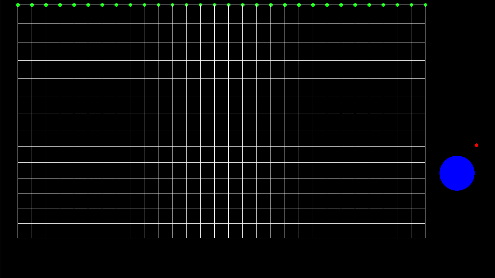
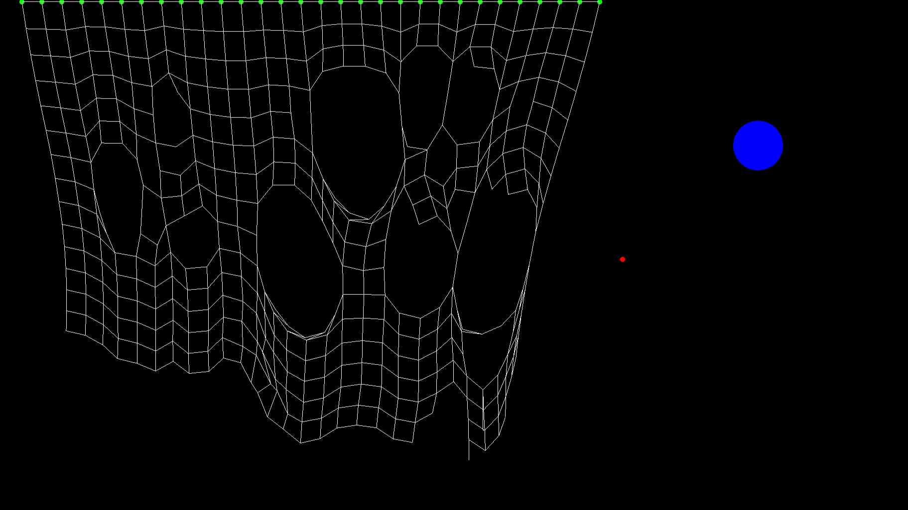
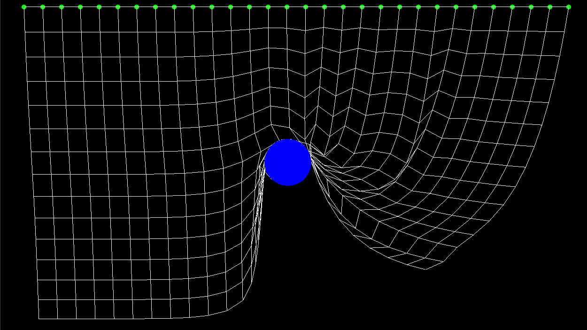

# 2D Cloth Simulation using Euler Integration

This project implements a 2D mass-spring cloth simulation. A pinned cloth reacts to gravity and wind, slides over a movable circular collision object, and can be dragged, cut and torn through real-time mouse interaction.

  
  
  

## Built With

* **Core & Graphics**: C++14, SFML 2.5

## Simulation Method

The cloth is modeled as a grid of point masses connected by springs, so each particle is tracked individually over time.

* The grid has 30 x 15 particles, spaced 40 px apart horizontally and vertically.
* Each particle is connected to its right and lower neighbors by structural springs. There are no shear or bend springs.
* The top row of particles is pinned and ignores all forces.
* Physics advances in fixed steps of 1/144 s using a time accumulator, so behavior does not depend on the rendering frame rate. A single frame is limited to 0.25 s of catch-up.

## Mathematical Model

Each spring follows Hooke's law. For a spring with stiffness $k$ and rest length $L$ connecting particles at positions $\mathbf{p}_1$ and $\mathbf{p}_2$, the force applied to $\mathbf{p}_1$ is:

$$\mathbf{F} = k\,(\lVert \mathbf{p}_2 - \mathbf{p}_1 \rVert - L)\,\frac{\mathbf{p}_2 - \mathbf{p}_1}{\lVert \mathbf{p}_2 - \mathbf{p}_1 \rVert}$$

The same force is applied in the opposite direction to $\mathbf{p}_2$. The acceleration of a particle with mass $m$ is the sum of all forces on it divided by $m$:

$$\mathbf{a} = \frac{1}{m}\left(\sum \mathbf{F}_{spring} + \mathbf{F}_{gravity} + \mathbf{F}_{wind}\right)$$

The simulation uses $k = 5$, $m = 10$, and a gravity force of $(0, 5)$. Wind adds a force along $(2, 2)$ scaled by a random per-particle, per-step gust.

## Simulation Steps

Each physics step updates the cloth through the following core steps:

* **Spring Forces**: Every intact spring computes its extension and adds equal and opposite forces to its two particles. A spring is removed (torn) when its length exceeds **2.5x** its rest length.
* **External Forces**: Gravity is added to every particle when enabled. Wind is added when enabled.
* **Euler Integration**: For each unpinned particle, the velocity is first damped, then updated using the accumulated acceleration, and finally used to advance the position:

$$\mathbf{v} \leftarrow 0.9\,\mathbf{v} + \mathbf{a} \qquad \mathbf{p} \leftarrow \mathbf{p} + \mathbf{v}$$

  * The acceleration is reset to zero after each step.
  * Because the velocity is updated before the position, this is the semi-implicit (symplectic) variant of Euler's method.
* **Collision Resolution**: Particles that end up inside the collision circle are moved to its surface along the direction from the circle's center. The velocity component pointing into the circle is removed, so the cloth slides over the object instead of sinking into it.

## Interaction

The application supports real-time interaction with the cloth and the collision object.

* **Dragging Particles**: In particle mode, the nearest particle within 10 px of the cursor is picked on click and held at the cursor position while the button is down.
* **Collision Object**: In object mode, clicking inside the blue circle grabs it, and it follows the cursor until the button is released.
* **Cutting**: While the right mouse button is held, any spring whose segment is within 4 px of the cursor's path during that frame is cut. The test uses the segment between the previous and current cursor positions, so fast swipes still cut cleanly.

## Controls

The application supports real-time interaction through the following mouse and keyboard inputs:

* **Left Mouse Button + Drag**: Moves the collision object or a cloth particle, depending on the current mode.
* **Right Mouse Button + Drag**: Cuts the springs the cursor passes over.
* **Middle Mouse Button**: Shows or hides all particles. By default, only the top row is drawn.
* **Down Arrow**: Toggles gravity on and off (on by default).
* **Up Arrow**: Toggles wind on and off (off by default).
* **Left Arrow**: Switches the left mouse button between moving the collision object (default) and moving cloth particles.
